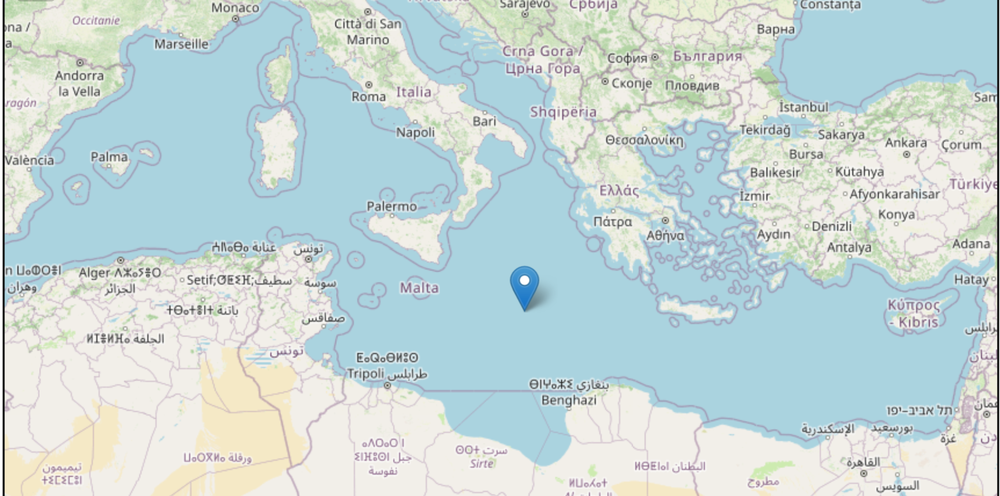
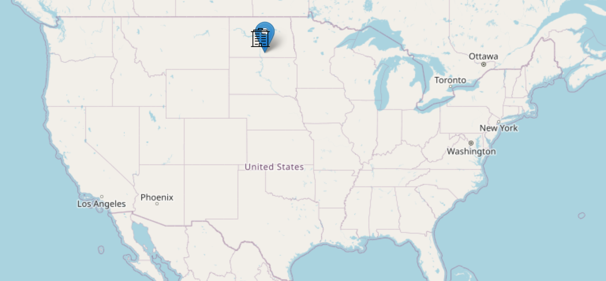
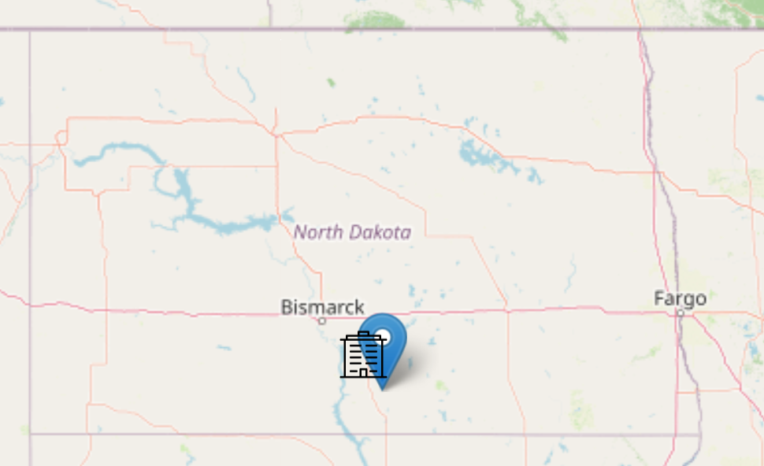

# Zadanie 1, część 1

Wykorzystując technikę _klas równoważności_ zaprojektuj _minimalną_ ilość przypadków testowych pokrywających następujące wymaganie:

```
- Jako turysta-podróżnik wybierający się do punktu Lon2, Lat2 chciałbym wiedzieć gdzie znajduje się najbliższy hotel.
```

Domyślny promień poszukiwań wynosi 30km.

## Rozwiązanie

### 1. identyfikator testu: 111_nie_ma_hoteli

- warunki wejściowe:
    - uruchom aplikację zgodnie z README
    - pobierz token ATK do obsługi API oraz zaloguj się nim
- kroki testowe
    - kliknij na środek Morza Śródziemnego  
      
- oczekiwany rezultat:
    - na liście nie wyświetla się żaden hotel

### 2. identyfikator testu: 112_jest_hotel

- warunki wejściowe:
    - uruchom aplikację zgodnie z README
    - pobierz token ATK do obsługi API oraz zaloguj się nim
- kroki testowe
    - kliknij na Linton w Północnej Dakocie
    - 
    - 
- oczekiwany rezultat:
    - na liście wyświetla się [tylko jeden hotel w Linton](https://www.guestreservations.com/cobblestone-inn/booking?utm_source=microsoft&utm_medium=cpc&utm_campaign=373113524&msclkid=08292905e81c15a0a09343d53d01d4c7&ctTriggered=true), który jest jednocześnie najbliższym hotelem