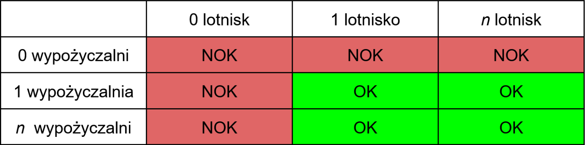

# Zadanie 1, część 3

Wykorzystując technikę _tablic decyzyjnych_ zaprojektuj _minimalną_ ilość przypadków testowych pokrywających następujące wymaganie:

```
- Jako turysta-podróżnik wybierający się do punktu Lon1, Lat1 chciałbym wiedzieć gdzie znajduje się najbliższe lotnisko i najbliższa wypożyczalnia samochodów (względem mojego miejsca docelowego). 
```

## Rozwiązanie



### 1. identyfikator testu: 131_zero_lotnisk_zero_wypozyczalni
- warunki wejściowe:
    - uruchom aplikację zgodnie z README
    - pobierz token ATK do obsługi API oraz zaloguj się nim
- kroki testowe
    - kliknij na środek Morza Śródziemnego
- oczekiwany rezultat:
    - w promieniu poszukiwań brak lotnisk i wypożyczalni, na liście nie wyświetlają się żadne pozycje

### 2. identyfikator testu: 132_jest_lotnisko_zero_wypozyczalni
- warunki wejściowe:
    - uruchom aplikację zgodnie z README
    - pobierz token ATK do obsługi API oraz zaloguj się nim
- kroki testowe
    - kliknij na lodowiec Metal Creek na Alasce
- oczekiwany rezultat:
    - na liście pojawiają się 2 pobliskie lotniska, lecz nie ma wypożyczalni

### 3. identyfikator testu: 133_zero_lotnisk_jest_wypozyczalnia
- warunki wejściowe:
    - uruchom aplikację zgodnie z README
    - pobierz token ATK do obsługi API oraz zaloguj się nim
- kroki testowe
    - kliknij na centrum Kalisza
- oczekiwany rezultat:
    - na liście pojawia się najbliższa wypożyczalnia, lecz nie ma lotniska

### 4. identyfikator testu: 134_jest_lotnisko_jest_wypozyczalnia
- warunki wejściowe:
    - uruchom aplikację zgodnie z README
    - pobierz token ATK do obsługi API oraz zaloguj się nim
- kroki testowe
    - kliknij na centrum Krakowa
- oczekiwany rezultat:
    - na liście pojawia się lotnisko Kraków-Balice oraz kilka wypożyczalni. Lista posortowana jest rosnąco wg odległości, zatem pierwsza wypożyczalnia jest najbliższa
